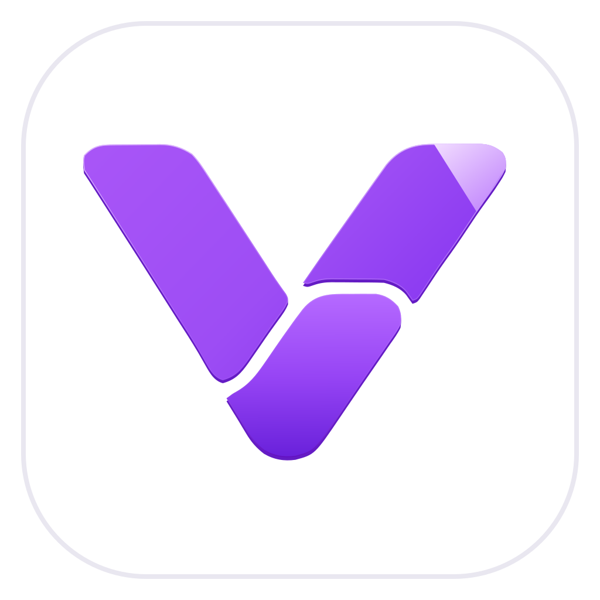
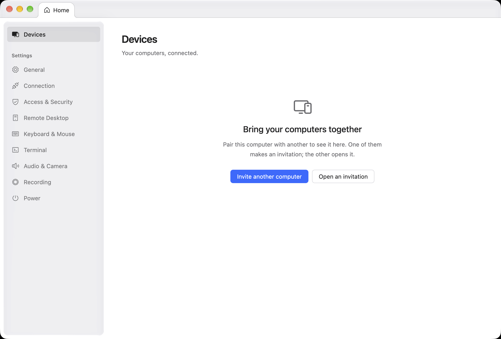

<p align="center">
  
</p>

<h1 align="center">VniLink</h1>

<p align="center">
  Reach your other computers from anywhere: see and control their screens, move files, and open a terminal.
</p>

<p align="center">
  <a href="https://github.com/sudosylabs/VniLink/actions/workflows/ci.yml"></a>
  <a href="LICENSE"></a>
  
  
</p>

<p align="center">
  <picture>
    <source media="(prefers-color-scheme: dark)" srcset=".github/readme/devices-dark.png">
    
  </picture>
</p>

## What it does

VniLink connects computers you have paired with each other, across macOS, Windows and Linux, in either direction.

- **Remote desktop.** Watch or control another computer's screen, with its pointer, keyboard, clipboard and sound.
- **Files.** Browse the other computer's disk and copy files both ways. Copies resume where they stopped.
- **Terminal.** Open a shell on the other computer, and keep it running across disconnects if that computer allows it.
- **Camera and recording.** Use the other computer's camera and microphone, and record a session.

Each computer decides what every paired computer may do. The screen, control, the clipboard, files, the terminal, the camera, the microphone, recording and restarting it are separate permissions, and allowing one computer to control another never lets the second control the first.

## How it works

You pair two computers once. One makes an invitation, a small `.vnl` file you send by any means (AirDrop, a message, a USB stick); the other opens it and types the six digits shown on the first. After that, each computer knows the other by its key, and nothing else can stand in for it.

Connections are end-to-end encrypted with [iroh](https://www.iroh.computer). They go directly between the computers whenever the networks allow it, and through a relay otherwise, with no ports to open on a router. By default VniLink uses iroh's public relays; an installation can name its own relays instead. A relay only forwards encrypted traffic.

The application is Electron with a TypeScript workbench, shaped after VS Code's. Pairing, permissions, connections, the desktop stream, files and the terminal are a Rust engine, with native capture, encoding and input for each operating system. [ARCHITECTURE.md](ARCHITECTURE.md) describes the contracts between the two.

## Status

VniLink is in development and has no published release yet. To try it, build it from source.

| Platform | Status |
| --- | --- |
| macOS on Apple silicon | Supported |
| Windows x64 | Supported |
| Linux x64: Ubuntu and Fedora | Supported |
| Linux arm64, and Linux desktops other than GNOME | Unverified |
| macOS on Intel | Unsupported |

Supported means the project develops and tests there.

## Build from source

[CONTRIBUTING.md](CONTRIBUTING.md#set-up-a-checkout) lists what each operating system needs. Then, from the repository root:

```sh
npm ci            # installs, and prepares Rust and Electron
npm run doctor    # what each task needs on this computer
npm run dev       # builds and starts the development app
```

`npm test` runs the test suite, and `npm run package:installers` builds this computer's installers.

## Contributing

Contributions are welcome: code, bug reports, testing on your platform, documentation and design. Start with [CONTRIBUTING.md](CONTRIBUTING.md) and follow the [Code of Conduct](CODE_OF_CONDUCT.md). Report vulnerabilities privately, as [SECURITY.md](SECURITY.md) describes.

## License

VniLink is licensed under the [GNU Affero General Public License, version 3 only](LICENSE). Anyone who uses a modified version over a network is entitled to its source, as section 13 of the license provides.

Files copied from VS Code keep Microsoft's MIT notice ([LICENSE.vscode.txt](LICENSE.vscode.txt), [ThirdPartyNotices.vscode.txt](ThirdPartyNotices.vscode.txt)), and `vendor/` holds third-party sources under their own licenses. Each source file states its license, and `npm run check:license` verifies it; [REUSE.toml](REUSE.toml) covers files that cannot carry a notice. The packaged application includes the licenses of what it bundles.
